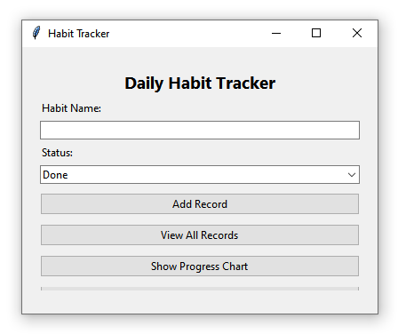
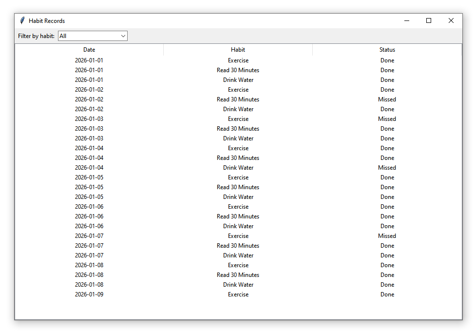
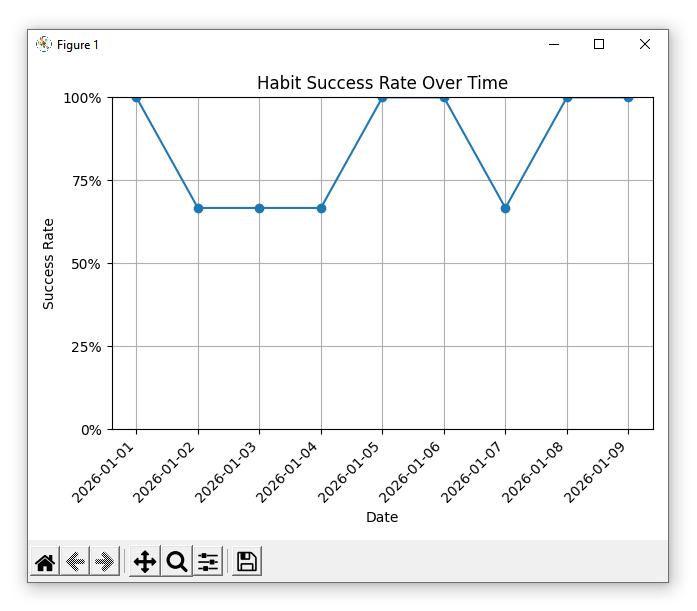

# Habit Tracker


## About the Project

Habit Tracker is a desktop application built with **Python**, **Tkinter**, **Pandas**, **Matplotlib**, and **Seaborn**.

It allows users to record daily habits as Done or Missed, browse and filter previous records, view daily progress charts, calculate individual habit streaks, and explore a calendar-style heatmap.

All records are stored locally in `data/habits.csv`, so the application works offline.

## Screenshots

### Main Window



### Habit Records



### Progress Chart


### Habit Heatmap



## Features

- Record habits as **Done** or **Missed**.
- Automatically assign the current date to new records.
- View saved records in a table.
- Filter records by habit.
- Display a daily success-rate line chart.
- Calculate current and longest streaks independently for each habit.
- Display a calendar-style heatmap of daily completion percentages.
- Store records locally in CSV format.
- Create the data directory and CSV file automatically when they do not exist.

## How Calculations Work

### Streaks

Each habit has its own current and longest streak.

- Consecutive `Done` records extend the streak when their dates are exactly one day apart.
- A `Missed` record breaks the streak.
- A gap between consecutive recorded dates also breaks the streak.
- The current streak refers to the latest recorded sequence. It is not automatically reset just because no record has been added today.

### Progress Chart

The chart converts statuses into numeric values:

- `Done` = 1
- `Missed` = 0

It calculates the mean for each date and displays the result as a percentage.

### Heatmap

The heatmap displays the percentage of distinct habits recorded on each date that were marked `Done`.

For example, if two habits were recorded on a date and one was completed, the heatmap shows 50%.

Habits without a record on that date are not included in the calculation. Dates without any records appear blank.

If the same habit has multiple entries on one date, the last CSV entry is used for calculations.

## Technologies Used

- Python
- Tkinter and ttk
- Pandas
- Matplotlib
- Seaborn
- Pathlib
- datetime

## Requirements

Install the required packages:

```bash
python -m pip install pandas matplotlib seaborn
```

Alternatively:

```bash
python -m pip install -r requirements.txt
```

## Installation and Usage

1. Clone or download the repository.
2. Install the required packages.
3. Run the application:

```bash
python habit_tracker.py
```

The application creates the `data/` directory and `habits.csv` file automatically if they do not exist.

Use the actual Python filename in the run command if it differs from `habit_tracker.py`.

## Tested Environments

The program was tested with the following combinations:

| Component | Environment 1 | Environment 2 |
|---|---:|---:|
| Python | 3.7.3 | 3.14.10 |
| Pandas | 1.3.5 | 3.1.1 |
| Matplotlib | 3.5.3 | 3.11.2 |
| Seaborn | 0.12.2 | 0.13.2 |

Python 3.7 is end-of-life. For a new installation, use a currently supported Python release. If using Python 3.7.3, install package versions compatible with that interpreter.

## Windows Font Warning

An earlier version of the chart used fire and trophy emojis in its streak labels. On some Windows systems, Matplotlib may display warnings such as:

```text
UserWarning: Glyph 128293 (FIRE) missing from current font.
UserWarning: Glyph 127942 (TROPHY) missing from current font.
```

These are font-rendering warnings. They do not indicate that the CSV file is damaged or that the habit calculations have failed.

The current program uses plain-text streak labels instead of those emojis. If the warnings still appear, check whether you are running an older copy of the program.

## Project Structure

```text
habit-tracker-python/
├── habit_tracker.py
├── README.md
├── article.md
├── requirements.txt
├── .gitignore
├── data/
│   └── habits.csv
└── screenshots/
    ├── main-window.png
    ├── habit-records.png
    ├── progress-chart.png
    └── heatmap.png
```

The application creates the `data/` directory and CSV file automatically. Avoid committing personal habit records to a public repository; use fictional sample data for demonstrations.

## Possible Future Improvements

- Weekly and monthly summaries.
- Custom habit categories.
- Editing and deleting records.
- Duplicate-entry warnings.
- Selectable date ranges.
- Export charts as PNG files.
- Additional reports and statistics.
- Dark mode.

## Article

For a more detailed explanation of the development process, calculations, and implementation, see:

[Building a Habit Tracker with Python, Tkinter, and Pandas](article.md)
